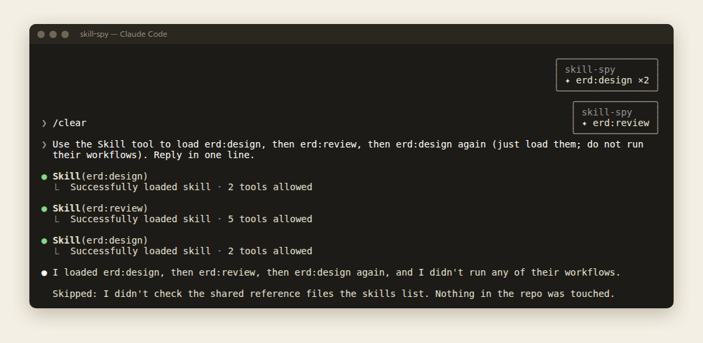
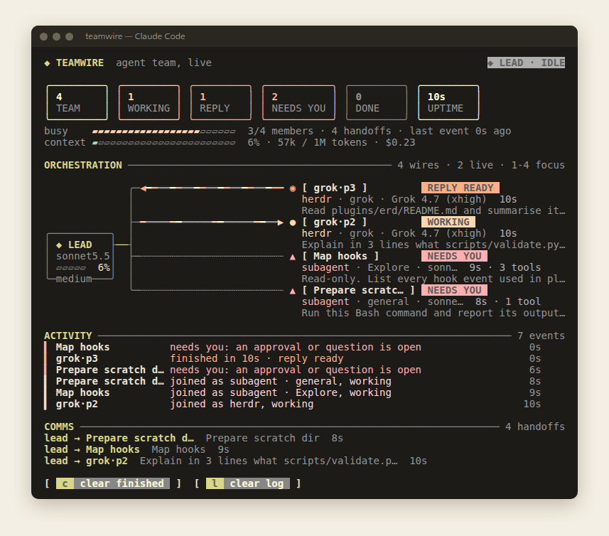
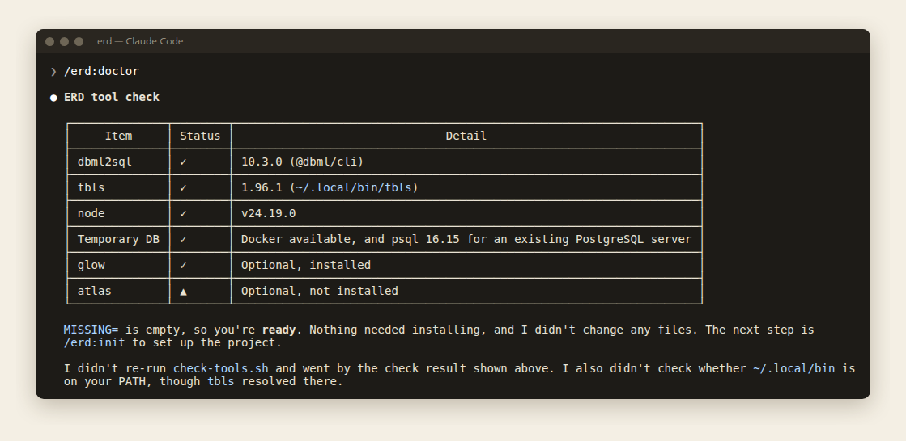

# dev-toolkit

[English](README.md) · [한국어](README.ko.md) · [日本語](README.ja.md) · **繁體中文**

devicki 的 Claude Code 外掛市集，收錄日常開發工作會用到的外掛與 mod。

| 外掛 | 版本 | 類型 | 說明 |
|---|---|---|---|
| [erd](plugins/erd) | 0.4.2 | 技能 | 用 DBML（結構描述的原始來源）和 tbls（文件、Mermaid ERD、lint）設計、記錄並維護專案的 ERD。支援 monorepo。 |
| [skill-spy](plugins/skill-spy) | 0.1.1 | mod | 每一輪結束時，為該輪用到的每個技能顯示一則提示。 |
| [teamwire](plugins/teamwire) | 0.1.8 | mod | 以即時配線圖呈現你的代理團隊，像電流一樣顯示領導與每位成員之間的往來。 |
| [grokbot-relay](plugins/grokbot-relay) | 0.5.1 | 技能 | 在 Claude Code 中透過本機 MCP 中繼向你的 Grok Bot 代理提問，並把工作階段的成果交給 Feedhand 作為發文請求。 |

## 安裝

在 Claude Code 中：

```
/plugin marketplace add devicki/dev-toolkit
/plugin install erd@dev-toolkit
/plugin install skill-spy@dev-toolkit
/plugin install teamwire@dev-toolkit
/plugin install grokbot-relay@dev-toolkit
```

在終端機中：

```bash
claude plugin marketplace add devicki/dev-toolkit
claude plugin install erd@dev-toolkit
claude plugin install skill-spy@dev-toolkit
claude plugin install teamwire@dev-toolkit
claude plugin install grokbot-relay@dev-toolkit
```

要更新時，執行 `/plugin marketplace update dev-toolkit`，再於開著的工作階段中執行 `/reload-plugins`。

## skill-spy：看看用了哪些技能

技能常常在你沒注意時就載入了：Claude 依你的要求自行挑選，或子代理事先載入。skill-spy 是一個 **mod**（只有 hooks 模組、沒有技能的外掛）。每一輪結束時，它會在右上角為該輪用到的每個技能顯示一則提示：



- **涵蓋技能啟動的所有方式：** 輸入 `/name`、Claude 自行呼叫 Skill 工具，以及子代理預先載入技能。
- **重複會計數：** 同一個技能在一輪中執行兩次，提示會顯示 `×2`。沒有用到技能的一輪不會顯示任何東西。
- **提示會停留 60 秒：** 點一下可提早關閉，滑鼠停在上面時不會消失。

運作方式：`skill.prompt` hook 在每個技能載入時計數，`turn.complete` hook 再顯示提示，並為下一輪重設計數。整個 mod 就是約 30 行的 [`hooks/register.ts`](plugins/skill-spy/hooks/register.ts)。

限制：

- 在**由組織管理的 Claude Code**（例如公司帳號）中，自行安裝的外掛收不到 `skill.prompt`，所以 skill-spy 不會有任何動作。
- 提示最多停留 60 秒，且只能顯示一行。兩者都是 Claude Code 的限制。
- mod 以你的使用者權限在 Claude Code 內執行，沒有沙箱。

更多：[plugins/skill-spy/README.zh-TW.md](plugins/skill-spy/README.zh-TW.md)

## teamwire：看著你的代理團隊工作

領導工作階段分派工作時，會開啟 `Team` 面板顯示配線圖：左邊是領導，每位成員各一條分支。每位成員會顯示狀態、`kind · agent · model · effort` 以及被交付的工作。成員工作時，火花從領導流向成員；成員的回覆等待讀取時，火花流回領導。



- 成員：子代理、agent teams 的隊友、其他 Claude 工作階段，以及搭配 [herdr](https://herdr.dev) 時，在 herdr 面板中執行的 codex、grok 等 CLI 代理。
- 每種成員有自己的線（`┅` 子代理、`═` 隊友、`━` herdr、`┉` 工作階段）。
- 顯示領導上下文視窗的儀表板、ACTIVITY 紀錄、聚焦單一成員的 FOCUS，以及成員需要你處理或團隊收工時的通知。
- 不消耗 token：hooks 只觀察事件並繪製面板。

更多：[plugins/teamwire/README.zh-TW.md](plugins/teamwire/README.zh-TW.md)

## grokbot-relay：和你的 Grok Bot 代理對話

使用 [devicki/grokbot-relay](https://github.com/devicki/grokbot-relay) 的 grokbot MCP 中繼（本機 Cursor BDK 伺服器，請先設定）的兩個技能。

| 指令 | 用途 |
|---|---|
| `/grokbot-relay:grokbot-relay` | 向允許的機器人提問並帶回回覆 |
| `/grokbot-relay:feedhand-handoff` | 把這個工作階段的成果（git log、PR、變更）做成給 Feedhand 的發文請求，確認後才送出 |

Claude 不撰寫也不核准最終貼文：由 Feedhand 起草，你在 Feedhand 聊天中核准。

更多：[plugins/grokbot-relay/README.zh-TW.md](plugins/grokbot-relay/README.zh-TW.md)

## erd：從結構描述設計到文件

用 DBML 撰寫結構描述，再以 tbls 產生各模組的文件、Mermaid ERD 和 lint 結果，全部用 Git 管理。如果專案已經有遷移工具（Alembic、Prisma、Flyway 等），就以該工具為原始來源，文件從它衍生。

| 指令 | 用途 |
|---|---|
| `/erd:doctor` | 檢查並安裝 tbls、@dbml/cli、Docker/psql（安裝前會先詢問） |
| `/erd:init` | 掃描專案、決定結構描述的原始來源、安裝範本 |
| `/erd:import` | 從原始碼、ORM 模型或遷移、ERD/ADR 文件或執行中的資料庫建立 DBML |
| `/erd:design` | 以對話方式設計或修改結構描述 |
| `/erd:review` | 對照後端與前端程式碼審查結構描述，依嚴重程度列出建議 |
| `/erd:sync` | 更新文件、檢查漂移、串接遷移產生、加入 CI 檢查 |



直接用一般的說法提出要求也可以，例如「幫我設計訂單需要的資料表」。技能會用你使用的語言回答。寫入專案的檔案依照各單位 `erd.env` 中的 `ERD_LANG=ko|en`（目前不支援中文，中文環境請選 `en`）。

更多：[plugins/erd/README.zh-TW.md](plugins/erd/README.zh-TW.md)

## 開發外掛

```bash
scripts/new-plugin.sh <name> --skill <first-skill> --desc "<description>"  # 建立骨架並加入市集
python3 scripts/validate.py [--base origin/main]                           # 檢查儲存庫結構（CI 也會執行）
claude plugin validate .                                                    # 官方的 manifest 檢查
plugins/<name>/tests/run.sh                                                 # 外掛回歸測試（erd）
claude plugin test plugins/<name>                                           # mod 測試（hooks 模組）
claude --plugin-dir plugins/<name>                                          # 只載入此外掛來啟動 Claude Code
```

```
.claude-plugin/marketplace.json   # 市集目錄
plugins/<name>/                   # 每個外掛一個資料夾，各有 README.md 與 CHANGELOG.md
docs/skill-authoring.md           # 技能撰寫規則
templates/plugin/                 # new-plugin.sh 使用的骨架
scripts/                          # validate.py、new-plugin.sh
```

CI（`.github/workflows/validate.yml`）會執行 `validate.py`、`claude plugin validate .`、skill-spy 與 teamwire 的測試，以及搭配 Postgres 的 erd 測試。

各外掛的變更記錄在各自的 `CHANGELOG.md`，市集層級的變更記錄在 [CHANGELOG.md](CHANGELOG.md)（皆為韓文）。

## 授權

[MIT](LICENSE)
